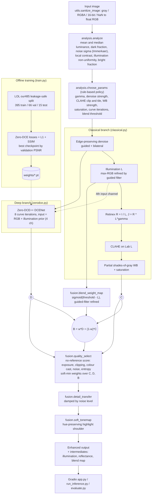

# LUMEN-X: adaptive low-light restoration (classical + Zero-DCE++ hybrid)

Problem P1 - Robust Low-Light Image Restoration and Enhancement. Live demo: **<ADD HF SPACE URL>** | Evaluated commit: **<ADD HASH>**



## Run
```bash
pip install -r requirements.txt
python app.py                                                     # Gradio UI on http://localhost:7860
python run_inference.py --input_dir samples --output_dir results  # CLI (add --compare for side-by-side strips)
docker build -t lumenx . && docker run -p 7860:7860 lumenx        # container
python -m pytest -q tests                                         # robustness tests, no GPU / weights needed
```
Without `weights/*.pt` (or without torch) the app runs the classical pipeline only and says so.

## Layout
| Path | Role |
|---|---|
| `lowlight/analysis.py` | image statistics + rule-based policy that sets all adaptive parameters |
| `lowlight/classical.py` | guided-filter illumination, Retinex, guided/bilateral denoise, CLAHE, white balance |
| `lowlight/zerodce.py` | Zero-DCE++ with optional illumination-prior channel; non-reference + supervised losses |
| `lowlight/fusion.py` | blend map, quality-aware selection, detail transfer, soft tone-map |
| `lowlight/pipeline.py` | modes `classical`, `dl`, `hybrid`, `auto`; ablation switches (`PipelineConfig`) |
| `lowlight/metrics.py` | PSNR, SSIM, LPIPS, NIQE, dE, colour cast, overexposure, noise gain, edge correlation |
| `train.py` / `evaluate.py` / `run_inference.py` / `app.py` | training, evaluation + ablation, CLI, UI |
| `scripts/` | data download + leakage-safe split, verification, eval-file generator |
| `docs/` | `DESIGN.md`, `architecture.png`, failure analysis, baseline audit, earlier technical report |

## Reproduce the results
```bash
bash scripts/download_data.sh data && python scripts/verify_data.py --data data
python train.py --data_root data/LOL --split_json data/splits.json --epochs 100 --hybrid --out weights/zerodce_hybrid.pt
python train.py --data_root data/LOL --split_json data/splits.json --epochs 100 --out weights/zerodce_rgb.pt
python evaluate.py --low_dir data/LOL/eval15/low --high_dir data/LOL/eval15/high --ablation --max_side 0 --out results/final/lol_eval15
python scripts/make_eval_md.py --lol results/final/lol_eval15 --usns <USNs> --team <T01> --out eval_P1_<T01>.md
```
Colab version: `notebooks/train_colab.ipynb`.

## Status (honest)
* **Baseline v0** results in `docs/AUDIT_AND_BASELINE_V0.md` used demo-only weights (200 steps, 6 synthetic photos). They are not the capability of the architecture.
* After the training run above, `weights/` holds checkpoints selected on the validation split and `eval_P1_<T01>.md` holds the final numbers.
See `docs/DESIGN.md` for method, limitations and ethics, and `docs/FAILURE_ANALYSIS.md` for failure cases.
